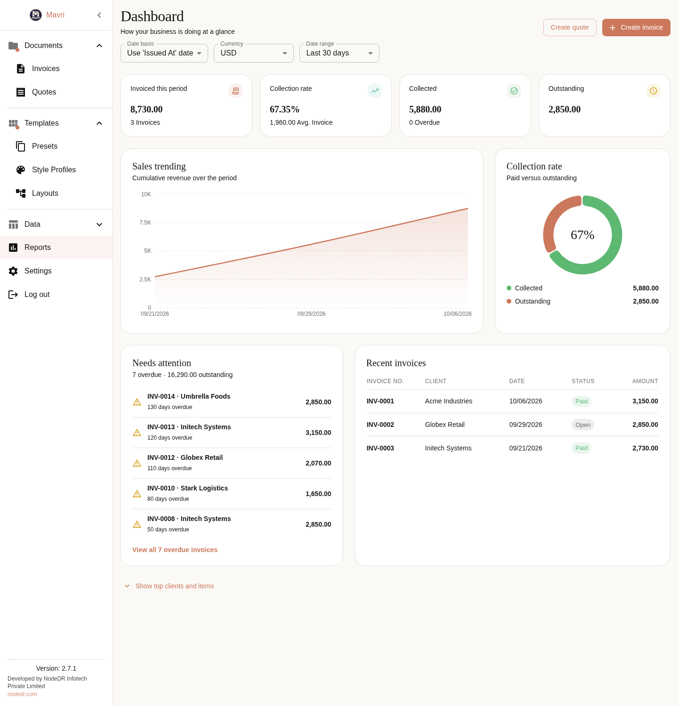
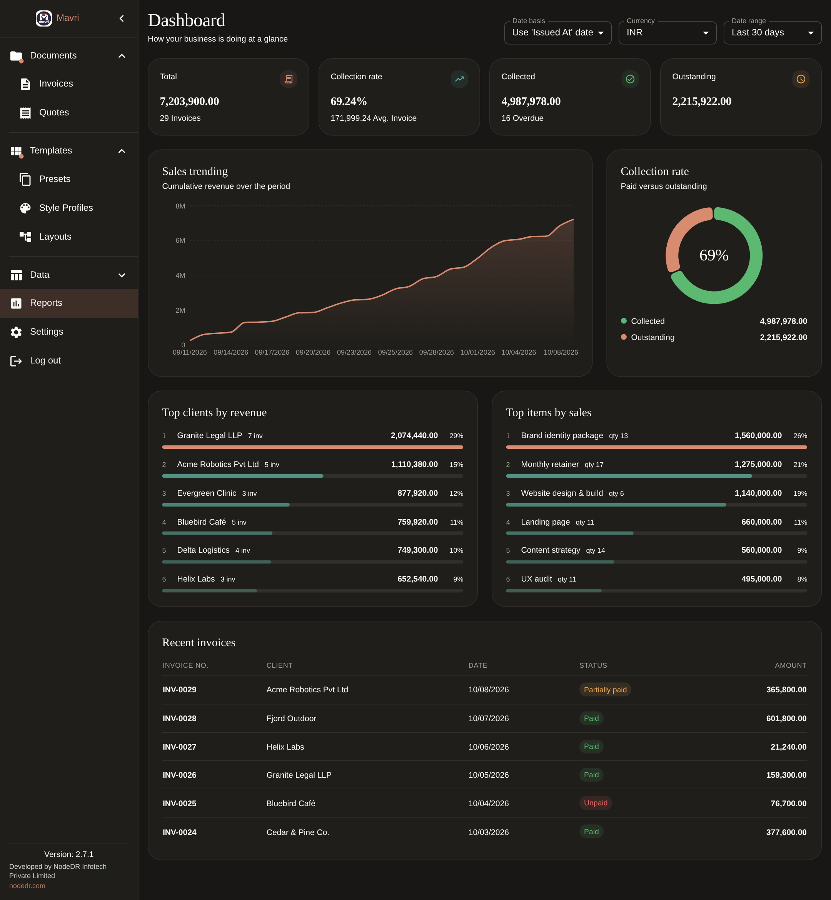
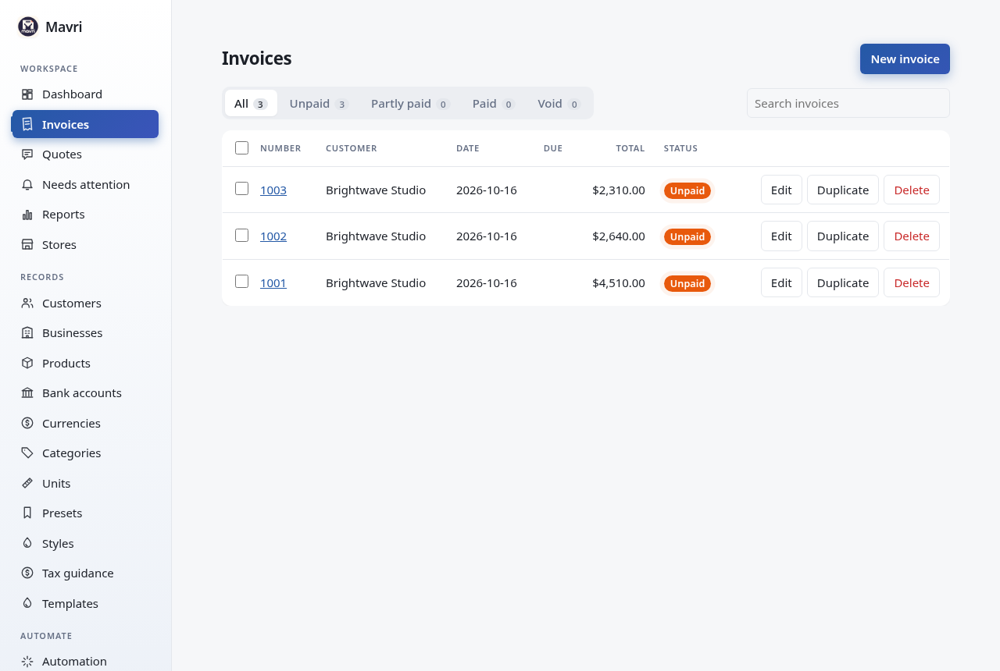
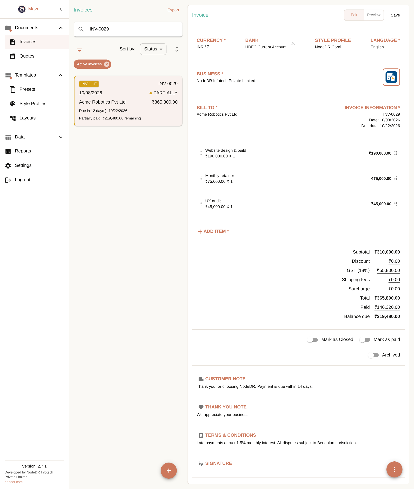
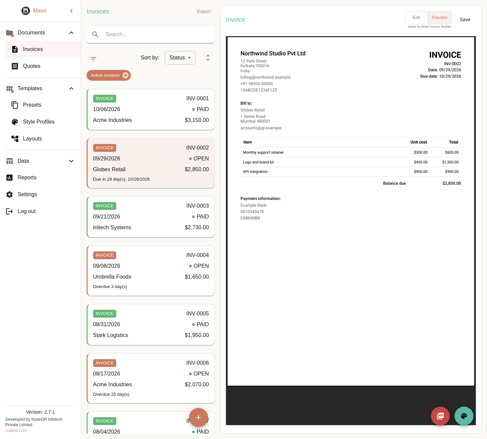
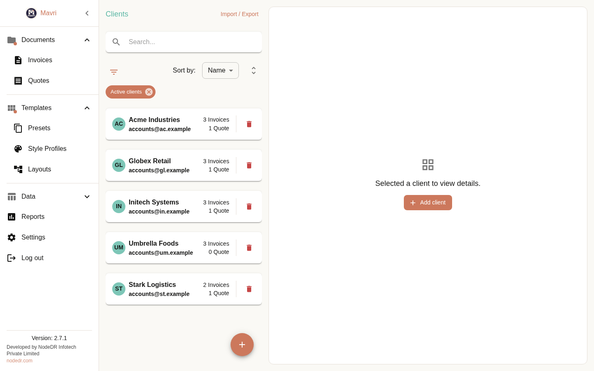
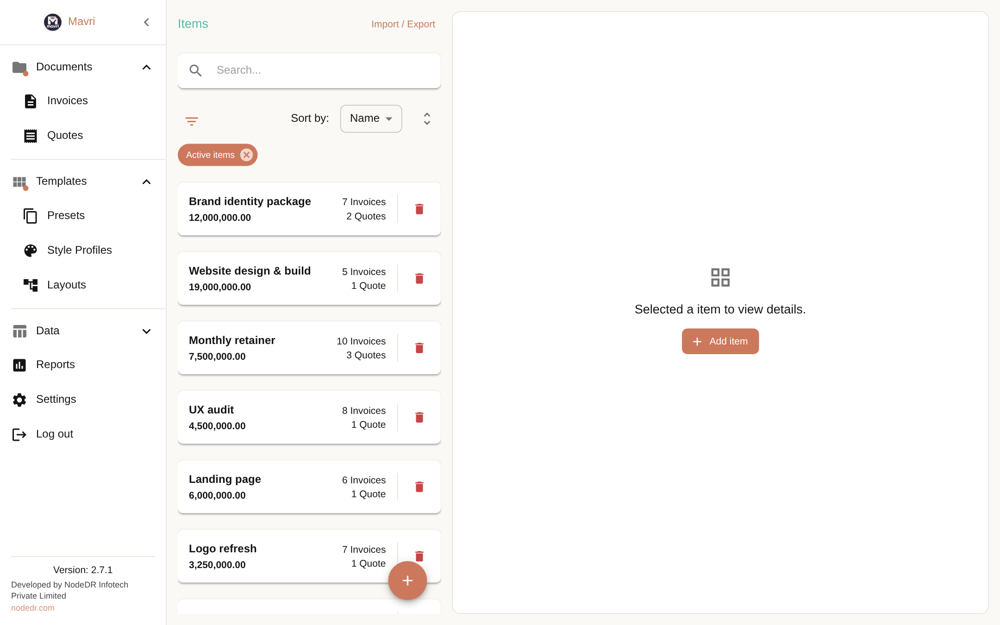
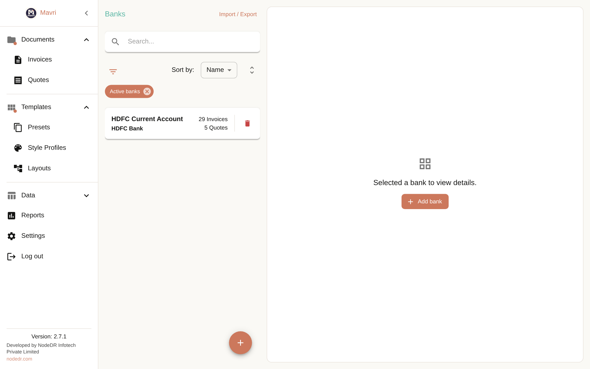
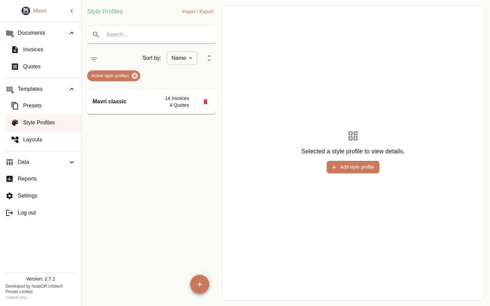
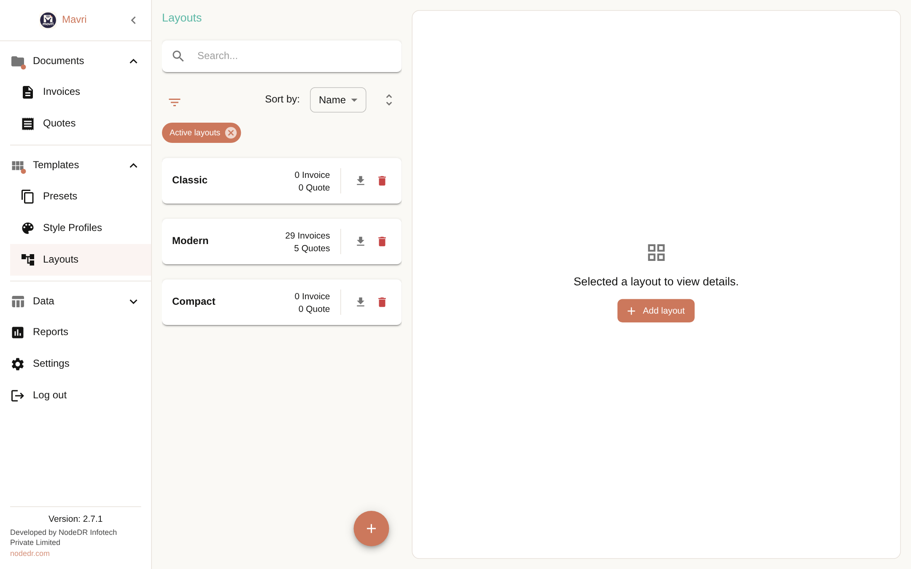

<p align="center">
  
</p>

<p align="center">
  
</p>

<h1 align="center">Mavri</h1>

<p align="center">
  Self-hosted invoicing and quotes for people who want to own their data.
  Create polished PDFs, track payments, and connect your tools through an API.
</p>

<p align="center">
  <a href="https://mavri.nodedr.com">Website</a> ·
  <a href="#get-started">Get started</a> ·
  <a href="docs/TUTORIAL.md">Tutorial</a> ·
  <a href="docs/reference/API.md">API reference</a> ·
  <a href="CONTRIBUTING.md">Contribute</a>
</p>

<p align="center">
  <a href="LICENSE"></a>
  <a href="docker-compose.yml"></a>
  <a href="docs/reference/API.md"></a>
  <a href="rewrite/internal/mcp"></a>
</p>

> The repository, container image, and current app identifiers still use `nodedr-invoice`. Keep those names in the commands below.

Mavri helps freelancers and small businesses create invoices and quotes without handing their business records to a hosted billing service. Run it on your computer or your own server. The app supports SQLite and PostgreSQL, and its invoice PDFs can be styled for your business.

## At a glance

| Make invoices | Keep control | Connect your workflow |
| --- | --- | --- |
| Quotes, payments, multi-currency documents, branded PDFs, UBL 2.1 and XRechnung exports | Local or self-hosted deployment, database backup and restore, JSON and XLSX import/export | REST API, signed Shopify/WooCommerce webhooks, and an MCP server |

<p align="center">
  
</p>

<p align="center">
  
  
</p>

*Screenshots use fictional demo data. The standalone [Mavri logo](mavri-logo.png) is available for project artwork.*

## Screens

<table>
<tr>
<td align="center"><br><sub>Invoices</sub></td>
<td align="center"><br><sub>Invoice editor</sub></td>
</tr>
<tr>
<td align="center"><br><sub>PDF preview</sub></td>
<td align="center"><br><sub>Quotes</sub></td>
</tr>
<tr>
<td align="center"><br><sub>Clients</sub></td>
<td align="center"><br><sub>Items</sub></td>
</tr>
<tr>
<td align="center"><br><sub>Banks</sub></td>
<td align="center"><br><sub>Style profiles</sub></td>
</tr>
<tr>
<td align="center"><br><sub>Layouts</sub></td>
<td align="center"><br><sub>Integrations</sub></td>
</tr>
</table>

Every screen is walked through in the [tutorial](docs/TUTORIAL.md).

## Get started

### Docker Compose

Requires Docker and Docker Compose. This path builds the app from this repository.

```bash
git clone https://github.com/Raktim94/nodedr-invoice.git
cd nodedr-invoice
docker compose up -d --build
```

Open **http://localhost:3001** and create the owner account. There is no database setup: on Docker and CasaOS, Mavri creates its database automatically on first start. Set `HOST_PORT=8080` to expose a different host port. Data persists in the `nodedr-invoice-data` Docker volume; back up that volume regularly. Behind an HTTPS reverse proxy (nginx, Caddy, Cloudflare Tunnel), set `COOKIE_SECURE=true` and `TRUST_PROXY=1`.

A prebuilt, version-pinned image is available at `ghcr.io/raktim94/nodedr-invoice:1.0.0` (amd64 and arm64).

### CasaOS / ZimaOS

Import [`casaos/docker-compose.yml`](casaos/docker-compose.yml) through **App Store → Custom Install → Import**. Open `http://<your-server>:8473` and create the owner account. The app stores data under `/DATA/AppData/nodedr-invoice/data`.

After you sign in, add a business, currency, client, item, bank, and layout; then create an invoice or quote and export its PDF. The [tutorial](docs/TUTORIAL.md) walks through the full flow.

## What Mavri can do

- **Invoices and quotes:** line items, discounts, surcharges, shipping, tax, partial payments, and status tracking.
- **Documents:** live PDF preview, A4 or Letter output, brand styles, layout presets, signatures, attachments, and payment QR codes.
- **International billing:** per-document currencies and languages, plus UBL 2.1, Peppol BIS Billing 3.0, and XRechnung export.
- **Dashboard:** a *Needs attention* queue of overdue invoices, quick *Create invoice* and *Create quote* actions, collection rate, and sales trend.
- **Business records:** clients, items, categories, banks, reports, search, filters, and archive.
- **Portability:** database backup and restore, JSON export/import, and XLSX import/export for most entities.
- **Integrations:** versioned REST API, e-commerce webhooks, and an MCP server for supported AI clients.

Each invoice and quote stores snapshots of its business, client, item, bank, currency, style, and layout details. Later edits to those records do not change existing documents.

## API and integrations

Create an API key in Mavri, then use the [`/api/v1` API](docs/reference/API.md) to create orders and fetch invoices. The order endpoint is idempotent for a given integration and external order ID.

```bash
curl -X POST http://localhost:3001/api/v1/orders \
  -H "Authorization: Bearer $KEY" \
  -H "Content-Type: application/json" \
  -d '{"integrationId":1,"externalOrderId":"ORD-1001","customer":{"name":"Acme Ltd","email":"billing@acme.test"},"lineItems":[{"name":"Consulting","quantity":2,"unitPriceMajor":150}]}'
```

Mavri also accepts HMAC-signed Shopify, WooCommerce, and generic webhooks. The MCP server is the `mcp` binary built from `rewrite/cmd/mcp` (see [rewrite/README.md](rewrite/README.md)). See [API.md](docs/reference/API.md) and the [tutorial](docs/TUTORIAL.md) for setup and examples.

## How it is built

The backend is a single Go program in [`rewrite/`](rewrite/README.md): REST API, MCP server, SQLite storage, webhooks and e-invoice export. It also serves the React app, so the whole product is one container of about 66 MB. It was written to match the earlier Express backend exactly (257 REST responses and 60 MCP replies compared with no differences before that backend was removed) and is exercised end to end with the real web app in Chrome. See [`rewrite/README.md`](rewrite/README.md) for what differs from the old behaviour and why.

## Project layout

| Path | What is in it |
| --- | --- |
| `src/renderer` | React and MUI user interface |
| `rewrite` | Go backend: REST API, MCP server, SQLite schema, tests and the browser end-to-end check |
| `docs` | Tutorial, API and layout references, screenshots, rewrite notes |
| `casaos`, `Dockerfile`, `docker-compose*.yml` | Container and CasaOS deployment |
| `scripts` | Developer helpers (translation sorting) |

## Documentation and development

[Tutorial](docs/TUTORIAL.md) · [API](docs/reference/API.md) · [Layout JSON reference](docs/reference/LAYOUT.md) · [Contributing](CONTRIBUTING.md) · [Security](SECURITY.md) · [Privacy](PRIVACY-POLICY.md)

For local development you need Node.js 20+ and Go 1.24+ (or Docker). Run the backend, then the web app:

```bash
git clone https://github.com/Raktim94/nodedr-invoice.git
cd nodedr-invoice
npm install
(cd rewrite && DEFAULT_DATABASE=invoice.db FRONTEND_ORIGIN=http://127.0.0.1:5173 go run ./cmd/server)   # API on :3000
VITE_API_URL=http://127.0.0.1:3000 npm run dev                                                   # web app on :5173
```

The stack is TypeScript, React and MUI for the interface, Go and SQLite for the backend, and Docker. Read [CONTRIBUTING.md](CONTRIBUTING.md) before proposing a change.

## Maintainer, origins, and license

**Created and led by [Raktim Ranjit](https://raktimranjit.com)** ([@Raktim94](https://github.com/Raktim94)) at [NodeDR Infotech Private Limited](https://nodedr.com). Raktim is the lead maintainer; see [MAINTAINERS.md](MAINTAINERS.md) for contact details. You can support the project through [GitHub Sponsors](https://github.com/sponsors/Raktim94).

Mavri is licensed under the [GNU Affero General Public License v3.0](LICENSE). Third-party notices are in [THIRD-PARTY-NOTICES.md](THIRD-PARTY-NOTICES.md). Contributions are welcome under the same license.
