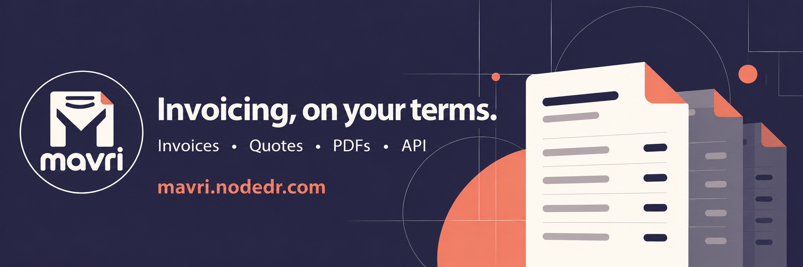
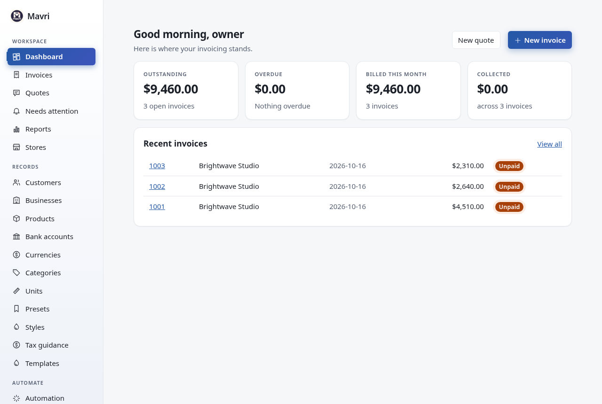
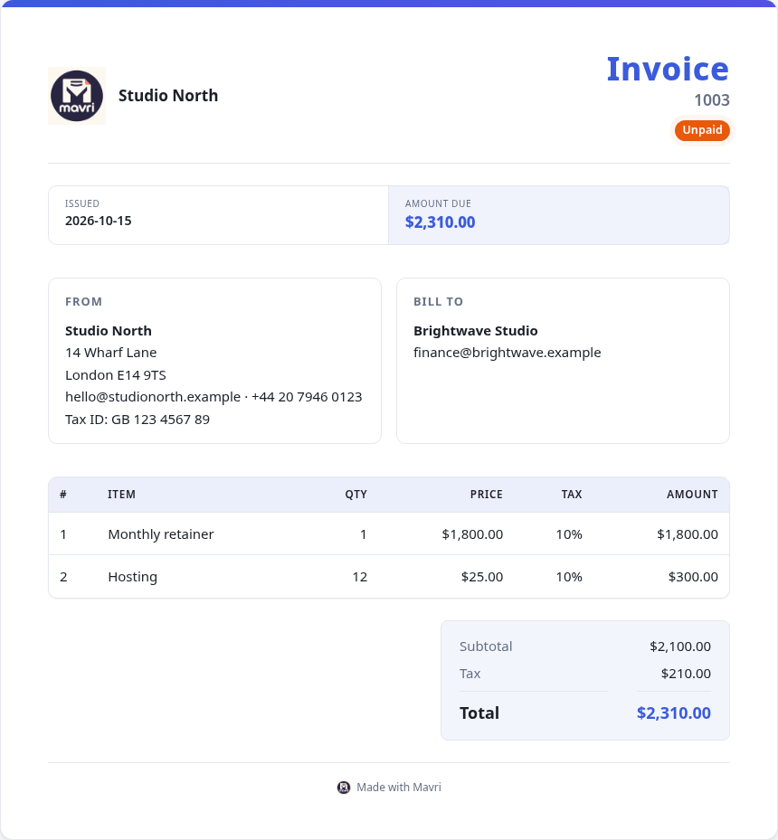
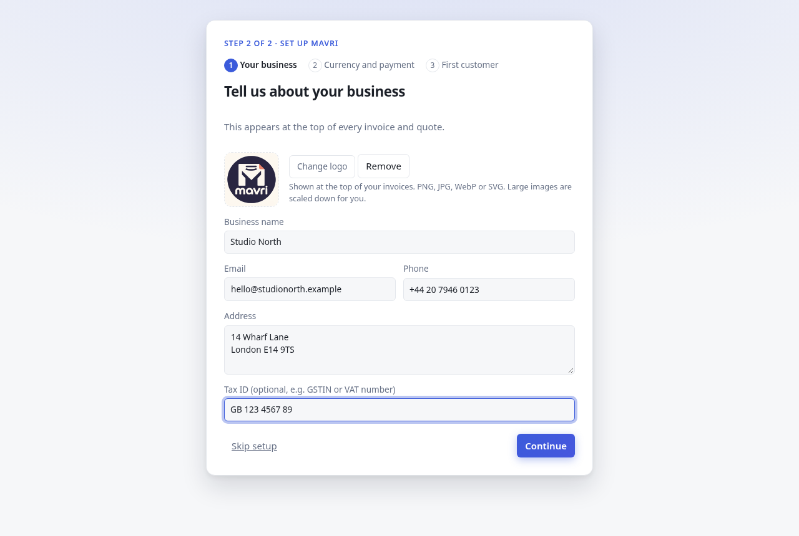
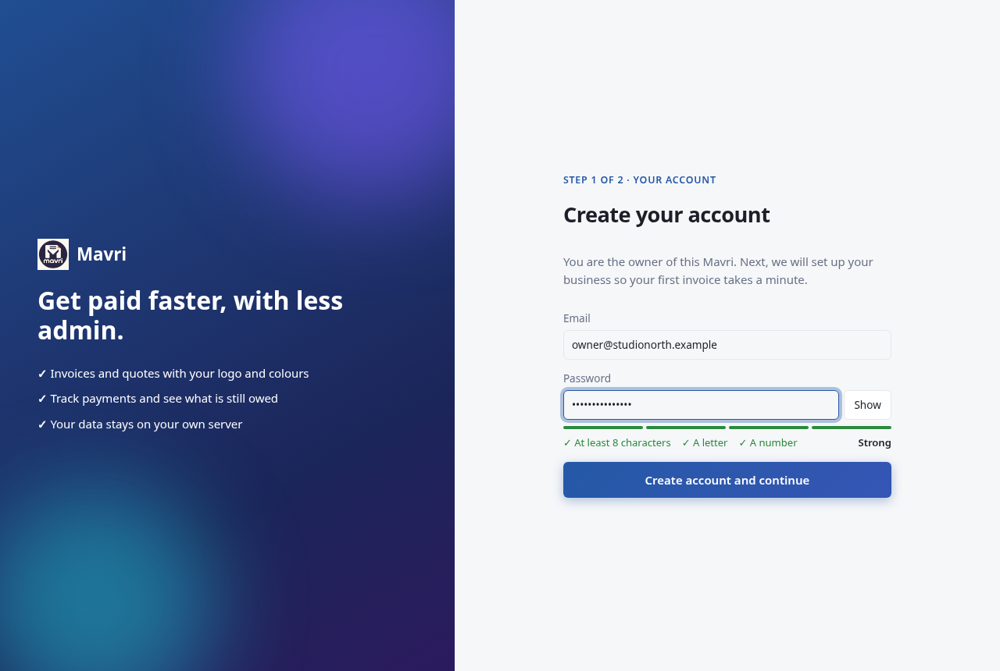
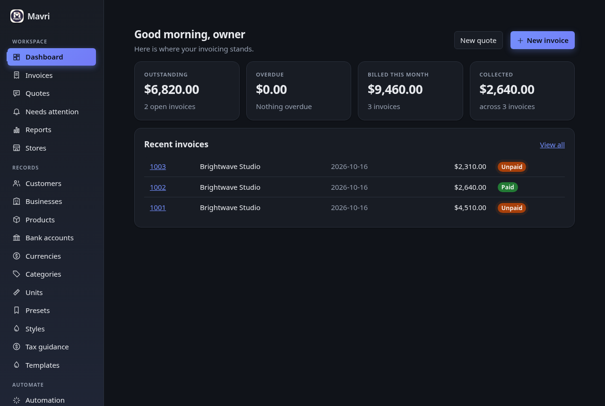

<p align="center">
  
</p>

<p align="center">
  
</p>

<h1 align="center">Mavri</h1>

<p align="center">
  Self-hosted invoicing and quotes for people who want to own their data.
  Create polished PDFs, track payments, and connect your tools through an API.
</p>

<p align="center">
  <a href="https://mavri.nodedr.com">Website</a> ·
  <a href="#get-started">Get started</a> ·
  <a href="docs/GUIDE.md">Guide</a> ·
  <a href="docs/API.md">API reference</a> ·
  <a href="CONTRIBUTING.md">Contribute</a>
</p>

<p align="center">
  <a href="LICENSE"></a>
  <a href="docker-compose.yml"></a>
  <a href="docs/API.md"></a>
  <a href="server/internal/mcp"></a>
</p>

Mavri helps freelancers and small businesses create invoices and quotes without handing their records to a hosted billing service. It is one small Docker container (about 54 MB) with a SQLite database that you own, a guided first run, and a one-click updater.

<p align="center">
  
</p>

## Why Mavri

|                            |                                                                                                                                                                                          |
| -------------------------- | ---------------------------------------------------------------------------------------------------------------------------------------------------------------------------------------- |
| **Polished documents**     | Your logo, colours and fonts on every invoice and quote. Print to PDF from the browser, or export UBL 2.1 and XRechnung XML.                                                             |
| **Yours alone**            | One container, one data folder, no accounts with anyone else, no analytics, no tracking. One-file backup and restore.                                                                    |
| **Set up in a minute**     | A guided first run takes you from account to business, logo, currency, bank details and first customer, with every step skippable.                                                       |
| **Gets you paid**          | Send invoices by email or a secure link, let clients pay online with Stripe, chase late payments with automatic reminders, and repeat invoices on a schedule.                            |
| **Stays current**          | An **Update now** button in Settings moves your install to the newest release in seconds and keeps your data.                                                                            |
| **Plays well with others** | Documented REST API (OpenAPI), signed webhooks in and out, CSV import and export, and an MCP server for AI tools that asks before it acts.                                               |
| **A real dashboard**       | Outstanding, overdue and billed totals, a setup checklist and your latest invoices the moment you sign in. Status tabs with counts, overdue flags, and friendly empty states everywhere. |
| **Looks the part**         | Light and dark themes, subtle motion that respects your system settings, and an invoice view built to be shown to clients. See the [design notes](docs/DESIGN.md).                       |

<p align="center">
  
  
</p>
<p align="center">
  
  
</p>

_Screenshots use fictional demo data. The standalone [Mavri logo](mavri-logo.png) is available for project artwork._

## Get started

### One command (installs Docker if you need it)

**macOS and Linux**

```bash
curl -fsSL https://raw.githubusercontent.com/Raktim94/mavri/main/scripts/quickstart.sh | bash
```

**Windows** (PowerShell)

```powershell
irm https://raw.githubusercontent.com/Raktim94/mavri/main/scripts/quickstart.ps1 | iex
```

The script checks for Docker and git, installs whichever is missing (Docker Desktop and git through Homebrew on macOS, Docker Engine and git through the system package manager on Linux), downloads Mavri into `./mavri` and starts it. On Windows it sets up WSL2 with the Docker Engine, so Docker Desktop is not needed; the first time, Windows may ask for one restart, after which you run the same command again. It is safe to run again, and it updates an existing checkout in place. Read [`scripts/quickstart.sh`](scripts/quickstart.sh) and [`scripts/quickstart.ps1`](scripts/quickstart.ps1) before you run them if you like. Set `HOST_PORT` to publish on a port other than 3001.

### Docker Compose

Requires Docker, Docker Compose and git already installed. This path builds the app from this repository.

```bash
git clone https://github.com/Raktim94/mavri.git
cd mavri
docker compose up -d --build
```

Open **http://localhost:3001** and create the owner account. There is no database setup: Mavri creates its SQLite database in the data volume on first start. Back that volume up, or use **Settings → Backup**. Behind an HTTPS reverse proxy (nginx, Caddy, Cloudflare Tunnel), set `COOKIE_SECURE=true` and `TRUST_PROXY=1`.

Or pull the published image: `docker pull ghcr.io/raktim94/mavri:2.5.0`. The `nodedr-invoice:1.0.0` image is an earlier, different version.

### CasaOS / ZimaOS

Import [`casaos/docker-compose.yml`](casaos/docker-compose.yml) through **App Store → Custom Install → Import**. Open `http://<your-server>:8473` and create the owner account. The app stores data under `/DATA/AppData/nodedr-invoice/data`.

Then follow the [guide](docs/GUIDE.md): the setup wizard adds your business, and you can create your first invoice straight away.

### Updating

On CasaOS (with the bundled updater container) open **Settings → Updates** and press **Update now**; Mavri downloads the new image, restarts in a few seconds and keeps your data. Anywhere else, pull the newest image and recreate the container. Version checks contact only GitHub and can be turned off with `UPDATE_CHECK=off`; see the [privacy policy](PRIVACY-POLICY.md).

## What Mavri can do

- **A one-page invoice composer:** customer, items, tax, dates, payment and brand in one flow, a live preview, a review that says what is required, recommended or optional, keyboard shortcuts, add a customer without leaving the page, and a draft kept in your browser.
- **Invoices and quotes:** line items from your catalog or typed freely, tax per line and per document (added, included or deducted), discount, surcharge, shipping, partial payments, status tracking, duplicate, and convert a quote to an invoice.
- **Fifteen templates:** from a plain ledger grid to GST, VAT and thermal layouts, with a gallery and sample previews. A template changes how a document looks, never its amounts.
- **Documents:** a printable page you can save as PDF from the browser, bank details, notes and terms, UBL 2.1 and XRechnung XML downloads, and document languages per customer (draft translations for French, German, Spanish, Italian, Portuguese, Dutch, Hindi and right-to-left Arabic).
- **Tax guidance:** India GST, UK VAT, EU VAT, UAE VAT and US sales tax: dated rates, tax number checks, a plain explanation of what usually applies with the missing facts and the decisions left to you, and a CGST/SGST/IGST split on the GST templates. It guides; it never applies a rate and files nothing. See [Tax guidance](docs/GUIDE.md#tax-guidance).
- **Records:** clients, businesses, items, bank accounts, currencies, categories and units, with archive and restore. Presets and styles speed up new documents.
- **Reports:** billed, paid and outstanding by month and by client.
- **Sharing and email:** a secure link per document that clients open without an account to read, print or save as PDF (and to accept or decline a quote, or tell you they will pay by a date or need help with an invoice); a Share button with the system share sheet, WhatsApp and copy link; email through your own SMTP server with editable templates and a delivery log.
- **Statements and customers:** match a bank statement to unpaid invoices (you confirm each match), a page per customer with what they owe by lateness, VIES checks of EU VAT numbers, and quiet hours so reminders respect a customer's time zone.
- **Getting paid:** UPI and SEPA payment QR codes with the same details as text, Stripe Checkout for cards (Mavri records the payment when Stripe confirms), automatic reminders before and after the due date, a **Needs attention** list of unpaid invoices that need a person, and promises to pay, disputes and pauses recorded per invoice. Scanning a QR code never marks an invoice paid, and Mavri never adds late fees.
- **Automation:** recurring invoices with a preview, "when a quote is accepted, draft an invoice", and bulk email, remind, mark paid and void.
- **History:** who changed what, when and from where (app, API, AI assistant, client link, automatic), exportable as CSV.
- **Data:** CSV import (customers, products and past invoices, with a check before anything is written) and export, a JSON export of every document, scheduled, encrypted backups to this server and to S3-compatible storage with a guided restore.
- **Operations:** a health page (database check, storage, backup age, webhook and email failures, recent errors).
- **Integrations:** versioned REST API described in OpenAPI, API keys, signed webhooks in from Shopify, WooCommerce or any sender (with a dry run that shows the invoice an order would become) and out for events such as `invoice.paid`, `payment.promised` or `customer.created`, and an MCP server for AI clients that needs your approval before it sends, pays, voids, deletes or changes what reminders go out.

Each invoice and quote stores a snapshot of its business, client, items, bank, currency and style. Later edits to those records do not change existing documents.

The interface is in English. The database is SQLite only. Documents stay editable after saving (there is no locked "issued" state or separate credit notes yet). Not included yet: anything that talks to a tax authority (e-invoice IRN, e-way bills, VIES or GST portal look-ups, filing), multiple user accounts and roles, payment providers other than Stripe, an interface in other languages, custom fields, PDF attachments in email (the email carries a link; the client saves the PDF from the page), and server-made PDFs. The tax packs and the document translations have not been reviewed by a professional. See [the status list](docs/DESIGN.md#status-against-the-master-product-brief).

## API and integrations

Create an API key in **Settings**, then use the [`/api/v1` API](docs/API.md) to create orders and fetch invoices. The whole API is described in [OpenAPI](server/internal/web/openapi.yaml) (also served at `/api/openapi.yaml`). The order endpoint is idempotent for a given store connection and external order ID.

```bash
curl -X POST http://localhost:3001/api/v1/orders \
  -H "Authorization: Bearer $KEY" \
  -H "Content-Type: application/json" \
  -d '{"shopId":1,"externalOrderId":"ORD-1001","customer":{"name":"Acme Ltd","email":"billing@acme.test"},"lineItems":[{"name":"Consulting","quantity":2,"unitPriceMajor":150}]}'
```

The MCP server is the `mavri-mcp` program in the image. Everything is documented in [docs/API.md](docs/API.md).

## Project layout

| Path                                          | What is in it                                          |
| --------------------------------------------- | ------------------------------------------------------ |
| `web`                                         | React user interface                                   |
| `server`                                      | Go backend: REST API, MCP server, SQLite schema, tests |
| `updater`                                     | Small sidecar behind the Update now button             |
| `e2e`                                         | Browser end-to-end check and the screenshot generator  |
| `docs`                                        | Guide, API reference, design notes, screenshots        |
| `casaos`, `Dockerfile`, `docker-compose*.yml` | Container and CasaOS deployment                        |

## Documentation and development

[Guide](docs/GUIDE.md) · [API](docs/API.md) · [Design](docs/DESIGN.md) · [Contributing](CONTRIBUTING.md) · [Security](SECURITY.md) · [Privacy](PRIVACY-POLICY.md)

For local development you need Node.js 20+ and Go 1.24+ (or Docker). Run the backend, then the web app:

```bash
git clone https://github.com/Raktim94/mavri.git
cd mavri
npm install
(cd server && DB_DIRECTORY=/tmp/mavri PORT=3001 go run ./cmd/mavri)   # API on :3001
npm run dev                                                                                         # web app on :5174, proxies /api
```

The stack is TypeScript and React for the interface, Go and SQLite for the backend, and Docker. Read [CONTRIBUTING.md](CONTRIBUTING.md) before proposing a change.

## Maintainer, origins, and license

**Created and led by [Raktim Ranjit](https://raktimranjit.com)** ([@Raktim94](https://github.com/Raktim94)) at [NodeDR Infotech Private Limited](https://nodedr.com). Raktim is the lead maintainer; see [MAINTAINERS.md](MAINTAINERS.md) for contact details. You can support the project through [GitHub Sponsors](https://github.com/sponsors/Raktim94).

Mavri is licensed under the [GNU Affero General Public License v3.0](LICENSE). Contributions are welcome under the same license. The third-party components Mavri ships with, all under permissive MIT or BSD licenses, are listed in [THIRD-PARTY-NOTICES.md](THIRD-PARTY-NOTICES.md).
