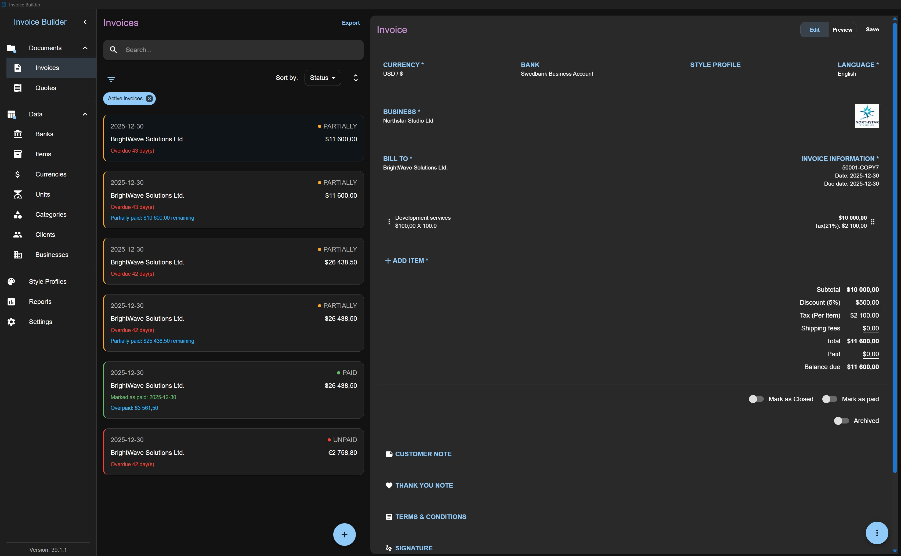
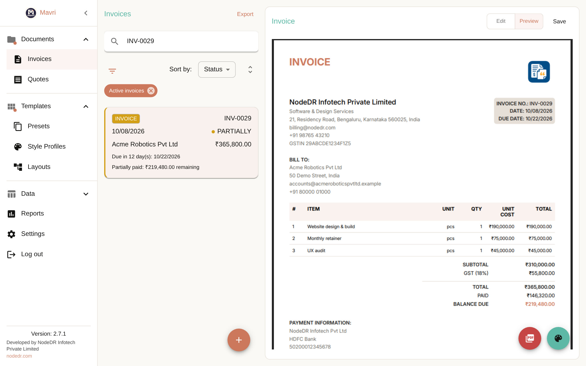

<p align="center">
  
</p>

<h1 align="center">NodeDR Invoice</h1>

<p align="center">
  <b>Self-hosted invoicing and quoting you fully own — with an API and an MCP server for everything else.</b>
</p>

<p align="center">
  <a href="LICENSE"></a>
  <a href="docker-compose.yml"></a>
  <a href="casaos/docker-compose.yml"></a>
  <a href="API.md"></a>
  <a href="src/backend/mcp"></a>
  <a href="Dockerfile"></a>
</p>

<p align="center">
  <a href="#-install">Install</a> ·
  <a href="#-features">Features</a> ·
  <a href="#-api--integrations">API</a> ·
  <a href="TUTORIAL.md">Tutorial</a> ·
  <a href="CONTRIBUTING.md">Contribute</a>
</p>

<p align="center">
  
  
</p>

---

**NodeDR Invoice** is an offline-first, open-source invoicing and quoting application for freelancers and small businesses.
Your data lives in a database file you own — no cloud, no subscription, no lock-in. Run it in Docker, on a CasaOS/ZimaOS home server, or as a desktop app.

## ✨ Why NodeDR Invoice?

- 🔒 **You own the data** — SQLite file (or PostgreSQL), full backup/restore, JSON and XLSX import/export
- 📴 **Offline-first** — works anywhere; nothing leaves your machine
- 🎨 **Beautiful, customizable PDFs** — branding, layouts, colors, typography, watermarks, signatures, payment QR
- 🇪🇺 **E-invoicing** — UBL 2.1, Peppol BIS Billing 3.0 and XRechnung export
- 🔌 **Connects to everything** — REST API with API keys, e-commerce webhooks (Shopify, WooCommerce, generic) and an MCP server for AI agents
- 🐳 **Easy to host** — Docker Compose, single container, and a ready CasaOS/ZimaOS app

## 📦 Install

| I have… | Best option |
| --- | --- |
| 🖥️ Linux, Windows, Mac, NAS or VPS | [Docker Compose](#docker-compose) |
| 🏠 CasaOS / ZimaOS | [CasaOS app](#casaos--zimaos) |
| 💻 Just my laptop | [Desktop app](#desktop-app) |

### Docker Compose

```bash
git clone https://github.com/Raktim94/nodedr-invoice.git && cd nodedr-invoice
docker compose -f docker-compose.standalone.yml up -d      # single container
# or: docker compose up -d --build                         # backend + frontend
```

Open <http://localhost:3001>. Change the port with `HOST_PORT=8080`. Data is kept in the `nodedr-invoice-data` volume.
A pre-built multi-arch (amd64/arm64) image is published to `ghcr.io/raktim94/nodedr-invoice:latest`.
Behind HTTPS, set `COOKIE_SECURE=true` and `FRONTEND_ORIGIN=https://your.domain`.

| Container | Port | Role |
| --- | --- | --- |
| `backend` | 3000 | Node.js REST API + SQLite/PG |
| `frontend` | 3001 | Static SPA served by nginx |

### CasaOS / ZimaOS

Import [`casaos/docker-compose.yml`](casaos/docker-compose.yml) via **App Store → Custom Install → Import**.
It runs one container on port **8473**, stores data in `/DATA/AppData/nodedr-invoice/data`, includes a healthcheck and restarts automatically.
Then open `http://<your-server>:8473` and create the owner account.

### Desktop app

Download the installer (Windows, macOS, Linux AppImage) from [Releases](https://github.com/Raktim94/nodedr-invoice/releases).

```bash
chmod +x NodeDR-Invoice-*.AppImage && ./NodeDR-Invoice-*.AppImage   # Linux
```

## 🔌 API & integrations

Create an API key in the app, then let other systems create and fetch invoices:

```bash
curl -X POST http://localhost:8473/api/v1/orders \
  -H "Authorization: Bearer $KEY" -H "Content-Type: application/json" \
  -d '{"integrationId":1,"externalOrderId":"ORD-1001",
       "customer":{"name":"Acme Ltd","email":"billing@acme.test"},
       "lineItems":[{"name":"Consulting","quantity":2,"unitPriceMajor":150}]}'

curl -H "Authorization: Bearer $KEY" "http://localhost:8473/api/v1/invoices?status=unpaid&search=acme&limit=20"
```

| Integration | What it does |
| --- | --- |
| **REST `/api/v1`** | Idempotent order → invoice, searchable and paginated invoice fetch. See [API.md](API.md) |
| **E-commerce webhooks** | Shopify, WooCommerce or generic HMAC-signed webhooks auto-create invoices |
| **MCP server** | `npm run mcp` exposes clients, items, invoices, payments and integrations to AI agents |

## 🧰 Features


### Core

- Create and manage **Invoices** and **Quotes**
- Offline-first: works without internet
- Database-file based (create or open a database anywhere)
- Automatic snapshotting of business, bank, style profile, layout, client, item, and currency data per invoice/quote
- Multi-currency support: choose the currency for each invoice/quote individually
- Responsive layout - usable on small and large screens, resizable windows supported
- Invoice/Quote translations - select a language per document, independent of app settings
- Export invoices in UBL 2.1 / Peppol BIS Billing 3.0 XML format
- Export invoices in XRechnung (UBL 2.1) XML format
- Native receipt printing for invoices and quotes in desktop Electron mode

### Business Data Management

- Banks, Businesses, Clients, Items, Categories, Units, Currencies
- Persistent search, persistent sort, persistent filter, archive (non-destructive)
- XLSX import/export for most entities
- Automatic creation of missing units/categories on item import

### Financial Flexibility

- Fixed or percentage surcharge
- Fixed or percentage discounts
- Shipping fees
- Tax: inclusive or exclusive, per-item or on total, deducted tax
- Partial payments, balance due tracking
- Invoice states: unpaid, partially paid, paid, closed
- Quote states: open, closed

### PDF Generation & Customization

- Live PDF preview
- A4 / Letter formats
- Layout presets
- Color, font size, font family customization
- Table header & row styles
- Quote & invoice watermarks
- Attachments: include images in PDFs
- Signature support: upload or hand-draw signatures
- Style profiles for invoices and quotes
- Layouts page for importing and managing JSON-driven invoice PDF compositions
- QR codes for payment in PDF

### Reports

- Aggregated data
- Charts and summaries

### Import, Export & Backup

- Full database backup & restore
- Export all data to JSON and import back
- Export to XLSX for most entities

### Settings & Customization

- Language selection: French, German, English, Lithuanian and Portuguese
- Number & date formatting
- Invoice/quote number prefix & suffix
- File name customization for exported PDFs
- Light & dark mode

## 🏁 Quick start

1. Launch the application and create the owner account (web) or a database file (desktop)
2. Add at least: a Layout, a Business, a Currency, a Client, a Bank, an Item
3. Create your first Invoice or Quote
4. Preview and export to PDF

## 📚 Documentation

[Tutorial](TUTORIAL.md) · [API](API.md) · [Layout JSON reference](LAYOUT.md) · [Contributing](CONTRIBUTING.md) · [Security](SECURITY.md) · [Privacy](PRIVACY-POLICY.md) · [Terms](TERMS-OF-USE.md)

## Data Model & Snapshots

When an invoice or quote is created, snapshots of the following are stored with the document:

- **Bank**, **Business**, **Client**, **Items**, **Currency**, **Style profile**, **Layout**

Changes to these entities do **not** affect existing invoices or quotes.

## Backups & Data Portability

- **Back up and reopen** the full database file
- **Export all data to JSON** and import it back
- **Import and export layout JSON** files
- **Export entities to XLSX** for manual editing
- **Import entities from XLSX**

## 🛠️ Development

```bash
git clone https://github.com/Raktim94/nodedr-invoice.git && cd nodedr-invoice
npm install
npm run dev                                # Electron desktop
npm run dev:react & npm run dev:webserver  # browser + REST API
```

**Stack:** TypeScript · React · MUI · Electron · Express · SQLite · `@react-pdf/renderer` · exceljs · Docker.
The look follows [DESIGN.md](DESIGN.md) (warm cream canvas, coral accent, serif headings).

```
src/
  backend/   main (Electron), webserver (REST), mcp, shared (services, migrations)
  preload/   Electron preload
  renderer/  React app (pages, state, shared UI)
```

Contributions of every kind are welcome — read [CONTRIBUTING.md](CONTRIBUTING.md).

## 🙏 Origins & license

NodeDR Invoice builds on the open-source [Invoice Builder](https://github.com/piratuks/invoice-builder) project by Evaldas L. (piratuks) and is licensed under the **GNU Affero General Public License v3.0** — see [LICENSE](LICENSE).

## 💖 Support

Maintained by Raktim Ranjit at [Nodedr Infotech Private Limited](https://www.nodedr.com/). Support the project via [GitHub Sponsors](https://github.com/sponsors/Raktim94).
