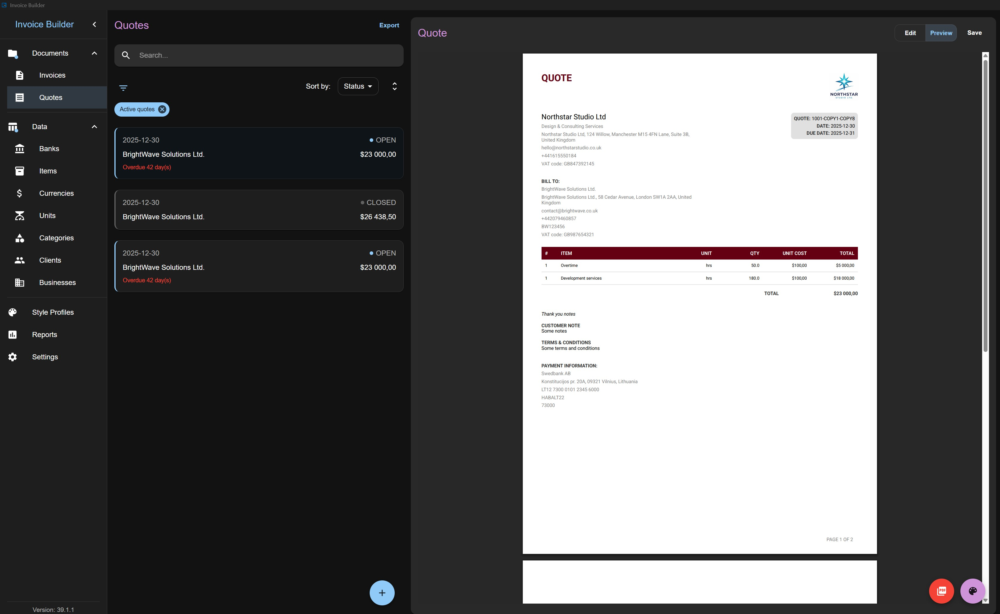

# NodeDR Invoice

[](LICENSE)
[](docker-compose.yml)
[](Dockerfile)

**Offline invoicing with full data ownership.**

**NodeDR Invoice** is an **offline-first, open-source invoicing and quoting application** for freelancers and small businesses who want full control over their data.

No accounts. No cloud. No subscriptions.  
Your data stays on your machine in a database file you own.

## Screenshots




## Why NodeDR Invoice?

NodeDR Invoice is designed for freelancers, contractors, and small businesses who want:

- **Full ownership of their data** - no cloud lock-in
- **Offline access** - works anywhere, anytime
- **A predictable, transparent tool** - no subscriptions, no hidden sync
- **Cross-platform support** - macOS, Windows & Linux
- **Import/export freedom** - JSON, XLSX, full database backups
- **Highly customizable PDFs** - branding, layout, colors, typography
- **UBL & Peppol BIS 3.0 support** - generate invoices that are compliant with European e-invoicing standards

If you value **privacy, portability, and control**, this app is built for you.

## Key Features

### Core

- Create and manage **Invoices** and **Quotes**
- Offline-first: works without internet
- Database-file based (create or open a database anywhere)
- Automatic snapshotting of business, bank, style profile, layout, client, item, and currency data per invoice/quote
- Multi-currency support: choose the currency for each invoice/quote individually
- Responsive layout - usable on small and large screens, resizable windows supported
- Invoice/Quote translations - select a language per document, independent of app settings
- Export invoices in UBL 2.1 / Peppol BIS Billing 3.0 XML format
- Export invoices in XRechnung (UBL 2.1) XML format
- Native receipt printing for invoices and quotes in desktop Electron mode

### Business Data Management

- Banks, Businesses, Clients, Items, Categories, Units, Currencies
- Persistent search, persistent sort, persistent filter, archive (non-destructive)
- XLSX import/export for most entities
- Automatic creation of missing units/categories on item import

### Financial Flexibility

- Fixed or percentage surcharge
- Fixed or percentage discounts
- Shipping fees
- Tax: inclusive or exclusive, per-item or on total, deducted tax
- Partial payments, balance due tracking
- Invoice states: unpaid, partially paid, paid, closed
- Quote states: open, closed

### PDF Generation & Customization

- Live PDF preview
- A4 / Letter formats
- Layout presets
- Color, font size, font family customization
- Table header & row styles
- Quote & invoice watermarks
- Attachments: include images in PDFs
- Signature support: upload or hand-draw signatures
- Style profiles for invoices and quotes
- Layouts page for importing and managing JSON-driven invoice PDF compositions
- QR codes for payment in PDF

### Reports

- Aggregated data
- Charts and summaries

### Import, Export & Backup

- Full database backup & restore
- Export all data to JSON and import back
- Export to XLSX for most entities

### Settings & Customization

- Language selection: French, German, English, Lithuanian and Portuguese
- Number & date formatting
- Invoice/quote number prefix & suffix
- File name customization for exported PDFs
- Light & dark mode

## Supported Platforms

- **Windows:** 10 or newer, 64-bit
- **Linux:** any modern distribution (Ubuntu, Debian, Linux Mint, etc.)
- **macOS:** 11.0 (Big Sur) or newer, Apple Silicon (M1/M2/M3/M4), 64-bit
- **Memory:** 2 GB RAM minimum
- **Disk space:** ~200 MB for the installer; ~550mb for the app

## PostgreSQL Support

NodeDR Invoice supports **two database backends**:

| Storage Type | Description | Best For |
| --- | --- | --- |
| **SQLite (local file)** | Simple, portable, zero-configuration database | Solo users, offline use, desktop mode |
| **PostgreSQL (server)** | Network-accessible database server | Multi-user setups, Docker deployments |

## Self-Hosting (Docker)

NodeDR Invoice can be self-hosted using Docker for users who prefer running it on their own server or NAS.

### Docker Image

A pre-built image is published automatically to GitHub Container Registry:

```bash
ghcr.io/raktim94/nodedr-invoice:latest
```

Pull it at any time with:

```bash
docker pull ghcr.io/raktim94/nodedr-invoice:latest
```

### Option A - Two containers (recommended)

The default setup runs backend and frontend as separate containers.

```bash
docker compose pull
docker compose up -d
```

| Container | Port | Role |
| --- | --- | --- |
| `backend` | 3000 | Node.js REST API + SQLite/PG |
| `frontend` | 3001 | Static SPA served by nginx |

### Option B - Single container

Run both backend and frontend in one container:

```bash
docker compose -f docker-compose.standalone.yml up -d
```

### One-click install

```bash
git clone https://github.com/Raktim94/nodedr-invoice.git && cd nodedr-invoice && ./install.sh
```

### Building locally

```bash
# Two-container build
docker compose up -d --build

# Or single container
docker build -t nodedr-invoice .
docker compose -f docker-compose.standalone.yml up -d
```

## Installation

Download the latest release from the **GitHub Releases** page:

[Download Latest Release](https://github.com/Raktim94/nodedr-invoice/releases)

### Linux AppImage

```bash
chmod +x NodeDR-Invoice-*.AppImage
./NodeDR-Invoice-*.AppImage
```

## Quick Start

1. Launch the application
2. Create a new database file or open an existing one
3. Add at least: a Layout, a Business, a Currency, a Client, a Bank, an Item
4. Create your first Invoice or Quote
5. Preview and export to PDF

## Tutorial

Detailed tutorials and usage guides are available here: [TUTORIAL](TUTORIAL.md)

Layout JSON structure and supported composition options are documented in [LAYOUT.md](LAYOUT.md).

## Data Model & Snapshots

When an invoice or quote is created, snapshots of the following are stored with the document:

- **Bank**, **Business**, **Client**, **Items**, **Currency**, **Style profile**, **Layout**

Changes to these entities do **not** affect existing invoices or quotes.

## Backups & Data Portability

- **Back up and reopen** the full database file
- **Export all data to JSON** and import it back
- **Import and export layout JSON** files
- **Export entities to XLSX** for manual editing
- **Import entities from XLSX**

## Development & Contributing

### Running Locally

Clone the repository, install dependencies, and start the development server:

#### Electron (Desktop App)

```bash
git clone https://github.com/Raktim94/nodedr-invoice.git
cd nodedr-invoice
npm install
npm run dev
```

#### Webserver / Browser

```bash
git clone https://github.com/Raktim94/nodedr-invoice.git
cd nodedr-invoice
npm install
npm run dev:react
npm run dev:webserver
```

### Environment Variables

- .env.development

```env
VITE_ENABLE_MOCKS={true|false}
VITE_API_URL={url}
```

- .env.production

```env
VITE_API_URL={url}
```

### Project Structure

```
/src
  /backend          - Electron + Webserver
    /main           - Electron main process
    /webserver      - Web server (REST API)
    /shared         - Environment-agnostic logic
  /preload          - Electron preload scripts
  /renderer         - UI code
    /app            - Core React application
    /pages          - React components related to routing
    /state          - Redux-related code
    /shared         - Shared UI components, hooks, utils
```

### Core Stack

- **Docker** - containerization for self-hosting
- **Electron** - cross-platform desktop framework
- **SQLite** - lightweight, reliable embedded database
- **TypeScript** - safer, maintainable code
- **React** - UI framework
- **MUI** - styling and UI components
- **exceljs** - XLSX import/export
- **@react-pdf/renderer** - PDF generation

### Contributing Guidelines

Contributions of all kinds are welcome - bug reports, feature ideas, documentation improvements, and pull requests.

- Report issues or features here: [ISSUES/FEATURES](https://github.com/Raktim94/nodedr-invoice/issues)
- Feature requests and discussions are welcome
- Please follow [guidelines](CONTRIBUTING.md)

## Documentation

- [Tutorial](TUTORIAL.md)
- [Layout JSON reference](LAYOUT.md)
- [Privacy Policy](PRIVACY-POLICY.md)
- [Terms of Use](TERMS-OF-USE.md)

## License

This project is licensed under the **GNU Affero General Public License v3.0**.  
See the [LICENSE](LICENSE) file for details.

## Support

NodeDR Invoice is maintained by Raktim Ranjit. Your support helps keep updates coming and new features rolling out!

You can support the project here: [GitHub Sponsors](https://github.com/sponsors/Raktim94)
