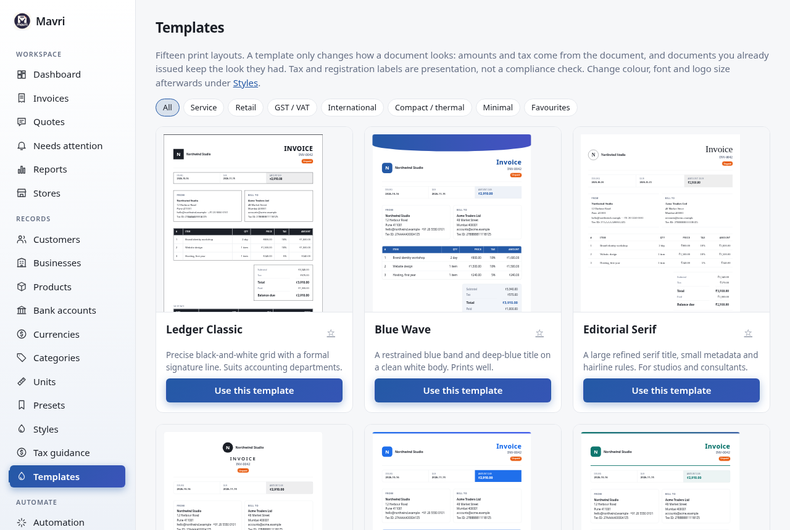
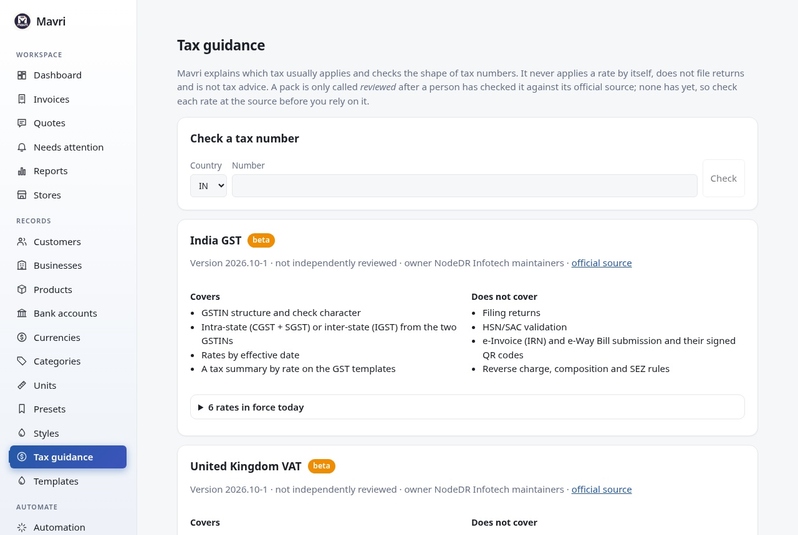
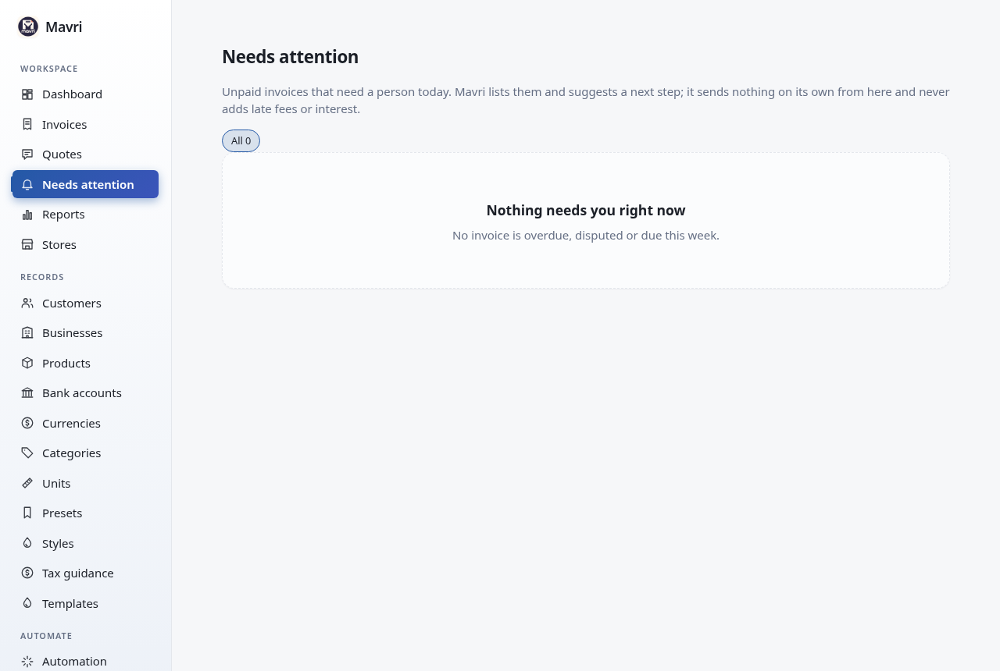

# Guide

This walks through Mavri from a fresh install to a sent invoice. Screenshots use fictional demo data.

## 1. Create your account

Open the app (http://localhost:3001 for Docker Compose). The first visit asks for an email and a password; this becomes the owner account. Use at least 8 characters with letters and numbers. Setup only works once; after that the page is a normal sign-in.

A short setup follows. Add your business (with a logo if you have one), pick a currency, add bank details and a first customer, or skip any step; everything can be changed later under **Businesses**, **Currencies** and so on.

## 2. Add what an invoice needs

The setup already created your business, a bank account and a customer if you filled them in. To add more:

Use the left menu:

- **Businesses**: who is sending the invoice (name, address, email, phone, tax ID). Add the country code, tax ID and e-invoice address here if you will export UBL or XRechnung.
- **Customers**: who you bill. Add an address, tax ID and country code for e-invoices, and a buyer reference if the customer requires one.
- **Products**: optional catalog of things you sell, with a price, a category and a unit. You can also type any line freely when you make an invoice.
- **Bank accounts**: optional payment details printed on the invoice.
- **Currencies**: common currencies are already there. Add others with their symbol and a format such as `{symbol}{amount}`.

Every list has _New_, _Edit_, _Archive_ and _Delete_. Archive hides a record without breaking old invoices; delete is refused while a record is in use.

## 3. Make an invoice

**Invoices → New invoice.** One page, in seven sections. A list on the left shows which still need something; a live preview of the finished document sits on the right (a button on narrow screens). Use the keyboard throughout: Tab between fields, **Enter** in the last line adds another, **Alt + ↑ / ↓** moves a line, **Ctrl + S** saves.

1. **Customer.** Choose the business. Search your customers by typing, or press **+ Add customer** to add one without leaving the page; the invoice keeps everything you typed. A preset fills the business, customer, currency, bank and notes in one step.
2. **Items.** Type a description, or start typing the name of a product from your catalogue to fill in its unit and price. Each line has quantity, price, tax rate, and whether the tax is _Added_ on top or _Included_ in the price. Lines can be moved up and down, duplicated and removed. Under _Discount, surcharge and shipping_ are the document-wide adjustments.
3. **Tax.** Mavri reads your business's country, the customer's country, both tax numbers and the date, and tells you which treatment usually applies and why (for example same state or different state in India, or reverse charge between EU businesses). It lists facts that are missing and decisions that are yours, and offers the current rates as buttons. It never applies a rate for you. See [Tax guidance](#tax-guidance).
4. **Dates and terms.** The invoice date and due date, with _Net 7 / 14 / 30 / 45 / 60_ shortcuts. The number is suggested from your numbering and becomes final when you save.
5. **Payment.** The currency and the bank account. You see what the client will see. If the invoice is in INR and the bank account has a UPI ID, or it is in EUR and the account is an IBAN, the invoice also shows a payment QR code (see [Payment QR codes](#payment-qr-codes)). Payments already received can be added here too.
6. **Brand and notes.** Pick a template and style (see [Templates](#templates)) and add the note, terms and thank-you line.
7. **Review.** Three lists: _Required to save_, _Recommended_ and _Optional_. Each item links to where to fix it. **Save**, or **Save and share** to open the share dialog right away.

Your work is kept in this browser while you type ("Draft saved 14:32"), so a refresh or an accidental click away does not lose it. When you come back it is restored, with a button to discard it. It is a convenience of this browser only; the invoice exists once you press Save.

After saving a new invoice you see a short confirmation with the number, customer, total and due date, and the usual next steps: share the link, send by email, download the PDF, record a payment, or create a similar invoice.

### Drafts, issuing and corrections

A new invoice starts as a **draft**: you can change anything, it does not count as owed, and it cannot be shared or emailed. **Issue invoice** locks it. From then on the figures, details, number and look cannot change, and it cannot be deleted; you can still record payments, record a refund, or void it. Mistakes are corrected with a **Credit note** (takes money off the invoice: everything, or some lines and quantities) or a **Debit note** (a further invoice for extra charges), both from the invoice page. They are numbered `CN-` and `DN-` (change the prefixes under Settings), issued at once, linked to the invoice, and cannot be edited. A credit note that covers the invoice marks it _Credited_. Invoices you made before this existed keep working as before: they stay editable.

Each line has a _Code, period and tax reason_ section: item code (SKU), tax code (HSN or SAC), service period, kind of line, and why no tax is charged (exempt, zero-rated, reverse charge, export). Products can carry a SKU, a barcode and a tax code, and typing or scanning either into a line picks the product. The Dates section has date of supply, purchase order and project fields and the customer's payment terms; the Payment section can show the total in a second currency at a rate you enter.

## 4. Send it

Open the invoice. Changes to a business or customer record do not change documents you already made; tick _Update details from their records_ when editing to copy them again. **Print / save as PDF** uses your browser's print dialog, so choose _Save as PDF_ as the printer. **UBL XML** and **XRechnung XML** download an electronic invoice; if a required field is missing, Mavri says which one.

A paid invoice shows the payment and a zero balance:

## Share, email and get paid

Open an invoice or quote and choose **Share**. Mavri makes a secure link that only opens that document. Your client needs no account: they read it, print it or save it as a PDF, download the UBL or XRechnung XML, and, for a quote, accept or decline it. Share opens your phone's share sheet where there is one, or WhatsApp or your email app with the message ready for you to check. Nothing is sent automatically. **Turn off link** stops it working.

**Email** sends the standard message with the link through your own mail server (set it up once in **Automation → Email**). You can edit the subject and text before it goes, and each email is logged on the document. Mavri sends a link rather than an attachment so the client always sees the current version.

**Online payments.** In **Automation → Online payments (Stripe)** add a Stripe webhook that points at your Mavri, then paste Stripe's signing secret and your secret key. Clients then see a **Pay** button for the balance. They pay on Stripe's page (card details never reach Mavri) and Mavri adds the payment and marks the invoice paid when Stripe confirms. Test with Stripe's test keys first. The public address in Automation must be an HTTPS address Stripe can reach.

## Templates

**Templates** has fifteen print layouts: Ledger Classic, Blue Wave, Editorial Serif, Studio Signature, Agency Services, Product Catalogue, GST India Detailed, GST India Compact, US Professional, UK VAT Standard, EU Cross-border VAT, UAE VAT, International, Milestone & Deposit and Thermal Counter (80 mm). Filter by service, retail, GST/VAT, international, compact or minimal; star favourites; click a thumbnail for a full preview with sample data. **Use this template** adds a style that uses it; change its colour, font and logo size under **Styles**, and pick it on an invoice.

A template changes only how a document looks. Amounts, tax and the saved details come from the document, and invoices you issued earlier keep the look they had. Labels such as GSTIN, VAT number or TRN are presentation: a template does not check or file anything. The GST templates show a tax summary by rate and, when both GSTINs are valid-looking, split it into CGST and SGST (same state) or IGST (different states).

## Tax guidance

Under **Tax guidance** you can see what Mavri knows about India GST, UK VAT, EU VAT, UAE VAT and US sales tax: each pack's status (_beta_ means rates, number checks and explanations; _estimate_ means Mavri holds no rates because they depend on place and product), its official source, the rates in force with the date each began, and, plainly, what it does not cover. No pack has been reviewed by a person against its source yet, and every pack says so. You can also check a tax number there: the GSTIN and UK VAT checks catch typing mistakes, the others check the shape; none proves a number is registered.

Mavri guides; it does not decide. It does not file returns, validate HSN/SAC codes, submit e-invoices (IRN) or e-way bills to a tax authority, or give tax advice.

## Payment QR codes

An invoice shows **How to pay**: a QR code where one exists, always with the same details as text. A UPI code (INR, with a UPI ID on the bank account) asks for the remaining balance and your invoice number; a SEPA code (EUR, with an IBAN) is the standard EPC credit-transfer code that European banking apps read. Everything else shows the bank details to copy. Scanning only opens the client's banking app with the details filled in; **it never marks an invoice paid**. When the money arrives, **Record payment** on the invoice. This QR code is a payment code, not the signed QR code some tax authorities require on an invoice, and Mavri does not make that one.

## Needs attention

**Needs attention** is the daily list of unpaid invoices that need a person, most urgent first: disputed, a promise to pay that was missed, an email that failed, overdue, due within a week, part paid, and promised. Each row says why and suggests a next step. Mavri sends nothing from this list and never adds late fees or interest.

On an invoice, **Collections** records what the client said: a promise to pay by a date, a dispute, a pause on automatic reminders, or a note. A dispute, a pause, or a promise that is not yet due stops automatic reminders for that invoice; when a promise date passes unpaid it moves up the list. Clients can tell you too: the secure link has _I will pay by a date_ and _I need help or want to dispute this_, which land here. Record a payment from the invoice page with **Record payment**; it is always a manual entry.

## Languages

Under **Customers**, set _Language of documents sent to this customer_. The labels, dates and number formats on their documents follow it (the secure link too). French, German, Spanish, Italian, Portuguese, Dutch, Hindi and Arabic are available as **draft translations**: useful, but not reviewed by a professional translator, so read them before you send. Arabic documents are laid out right to left. English is the default. The app itself and the text you type (descriptions, notes) stay as they are. PDFs are your browser's print output, so the fonts that show a script are the ones on the device doing the printing.

## Reminders and recurring invoices

In **Automation → Payment reminders** choose the days before and after the due date; Mavri emails the customer once for each invoice and day, and stops when the invoice is paid. Untick reminders on a customer's record to exclude them, or press **Remind** on an invoice to chase it by hand. Reminders need email and the public address.

**Repeat** on an invoice starts a schedule (every week, month, quarter or year, with an optional end date) and shows the dates it will issue before you start. Each copy is a normal invoice with the next number; tick _Email each new invoice_ to send it automatically. The Automation page lists the schedules and lets you pause or stop them. A rule there can also draft an invoice whenever a quote is accepted.

In the invoice list, tick rows to **email**, **remind**, **mark paid** or **void** many at once, or export just those rows. You get a result for every invoice, so one problem never hides the rest.

## Activity

**Activity** records who changed what, when and where from: the app, the API, an AI assistant, a client's link or an automatic job. Filter it, search it, and **Export CSV**.

## Integrations

**Integrations** adds webhooks: Mavri sends a signed message to your URL for events such as `invoice.created`, `invoice.paid`, `quote.accepted` or `payment.failed`. Failed deliveries are retried (after 1 minute, 5 minutes, 30 minutes, 2 hours and 6 hours), every delivery is logged, and **Replay** sends one again. The page also has copy-ready examples, including how to check a signature. The whole API is in `/api/openapi.yaml`.

## People

Under **Settings → People** an owner adds the people who sign in: **Owner** (everything), **Staff** (invoices, quotes, records, CSV and email; not settings, payments, backups, API keys or people) and **Viewer** (read only). Give a new person a first password and tell them; they can change it under **Settings → Your password**. Resetting a password signs that person out everywhere. There is always at least one owner.

## Data and backups

**Data & backups** exports customers, products, invoices and payments as CSV, and every invoice and quote as one JSON file (exactly as the API returns it, with the details each was saved with), so your records can leave Mavri without loss. **Lines** exports one row per document line, and **Journal** exports a balanced double-entry journal of what was issued and received (accounts receivable, sales, tax and bank, with plain account names to map in your accounting software; drafts, quotes and void invoices are left out). Mavri is not an accounting system; these are the way into yours. It imports customers, products and past invoices. Choose the file, **Check file**, read what will happen (and download the list of rows with problems), then import.

For invoices, use one row per line item: `invoice number, customer, date, currency, description, qty, unit price, tax %`, and optionally `customer email, due date, total, paid, paid on, issuer`. Rows with the same invoice number become one invoice. An invoice with any problem is skipped whole and each problem is listed with its line, so you can fix the file and import it again; invoices that already exist are skipped, so importing twice is safe. If the file has a `total` column, Mavri checks it against what the lines add up to, which catches wrongly mapped price or tax columns.

Backups can run on a schedule, with a number of copies kept. Turn on **Encrypt** to protect them with a passphrase you keep elsewhere, and add an S3-compatible bucket (Amazon S3, Backblaze B2, Cloudflare R2, MinIO and others) for an off-site copy. Every backup is read back and checked right after it is made. The screen shows the last good backup and tells you if backups fall behind.

A backup contains your invoices, quotes, payments, customers, businesses, products, banks, styles, presets, schedules, share links, promises and disputes, and history. It does **not** contain sign-in accounts, API keys, store connections, webhook endpoints, or the email, backup and payment settings and their passwords, and never the server's encryption key. After restoring on a new server, add those again. **Restore** is a guided check: pick a copy, enter the passphrase if it has one, see what it holds, confirm. A safety copy of your current data is made first.

## Health

**Health** shows whether the database passes its integrity check, how much space the data uses, how old the last backup is, webhook and email failures in the last day, and recent warnings and errors.

## Quotes

**Quotes** works the same way. When a customer accepts (through their link, or you convert it), the quote is marked accepted. Open it and choose **Convert to invoice**, or switch on the Automation rule to draft the invoice for you.

## Presets and styles

A **preset** is a saved combination of business, customer, currency, bank and notes. A **style** stores accent colour, font, text size, page size and which columns to show.

## Reports

**Reports** adds up billed, paid and outstanding amounts by month and by client for a chosen year, per currency.

## Stores

**Stores** connects an online shop. Connect a store, then copy the webhook URL and the signing secret (shown once) into Shopify, WooCommerce or your own system. Each order becomes an invoice, once.

## Settings

Invoice and quote number prefixes, and switches that hide features you do not use. **Backup** downloads everything as one file and restores from it; scheduled and encrypted backups are in **Data & backups**. **API keys** let scripts and tools talk to Mavri; the secret is shown once. **Updates** shows your version and whether a newer one is published; on CasaOS, with the bundled updater container, **Update now** pulls the new version and restarts Mavri in a few seconds (your data is kept). Elsewhere it tells you that a new version exists and you update the way you installed.

## All screens

