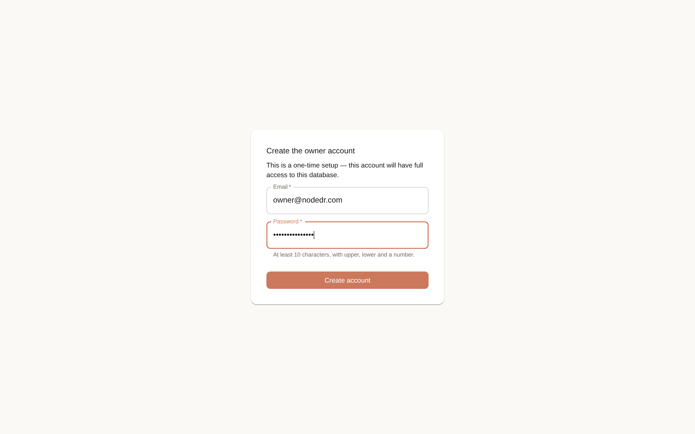
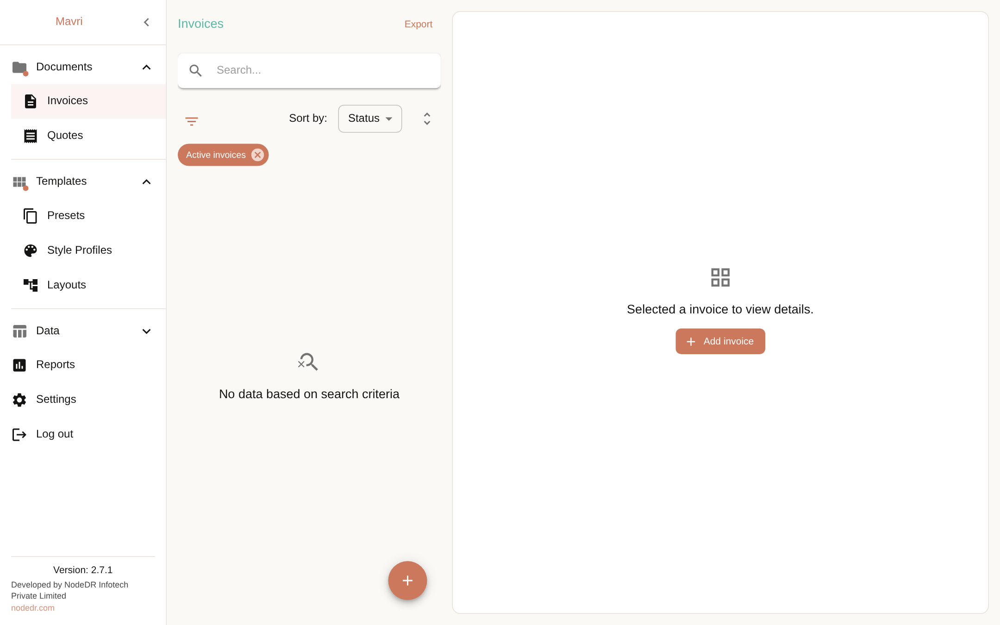
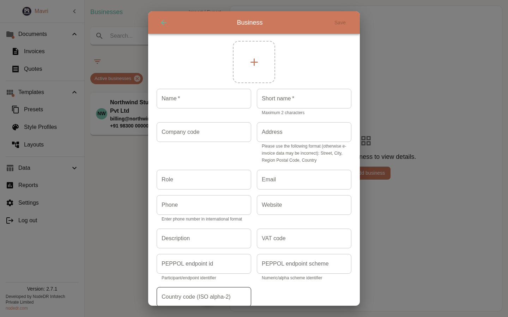
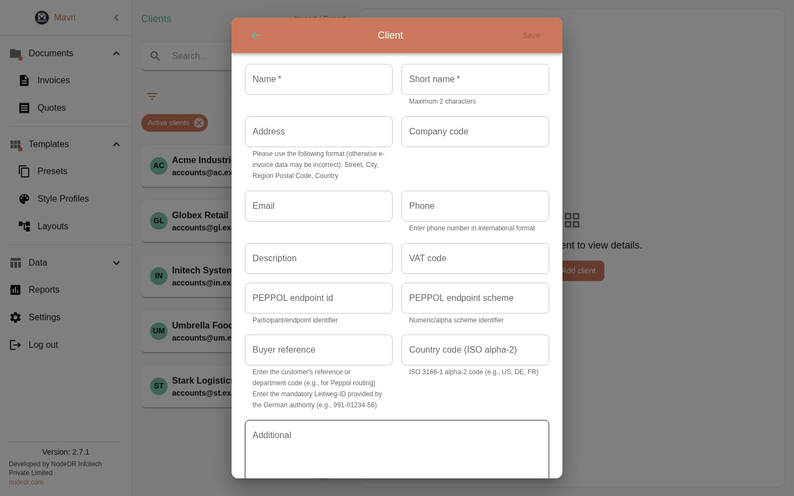
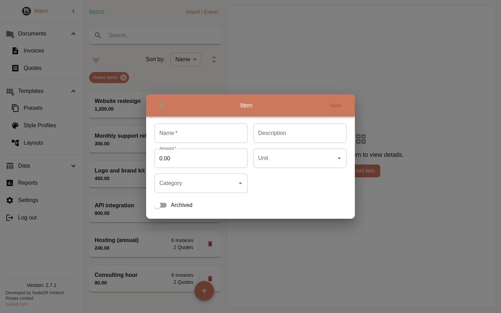
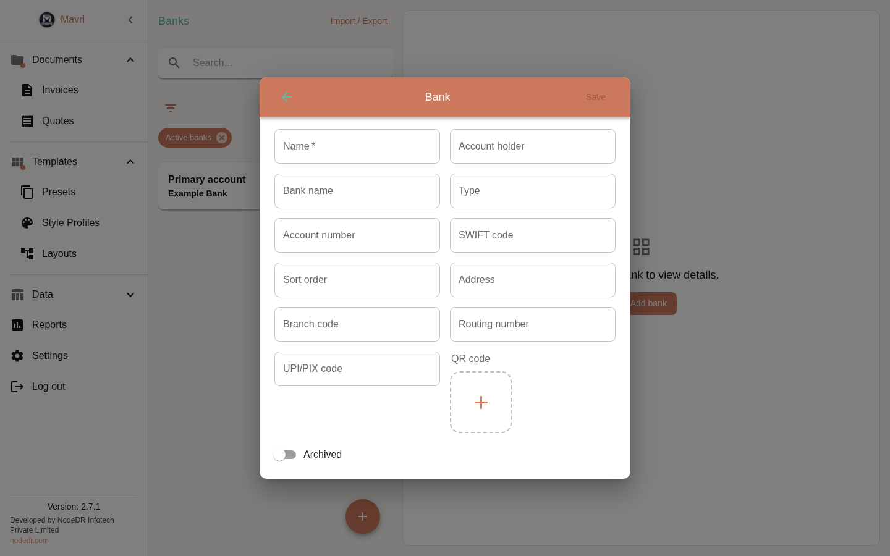
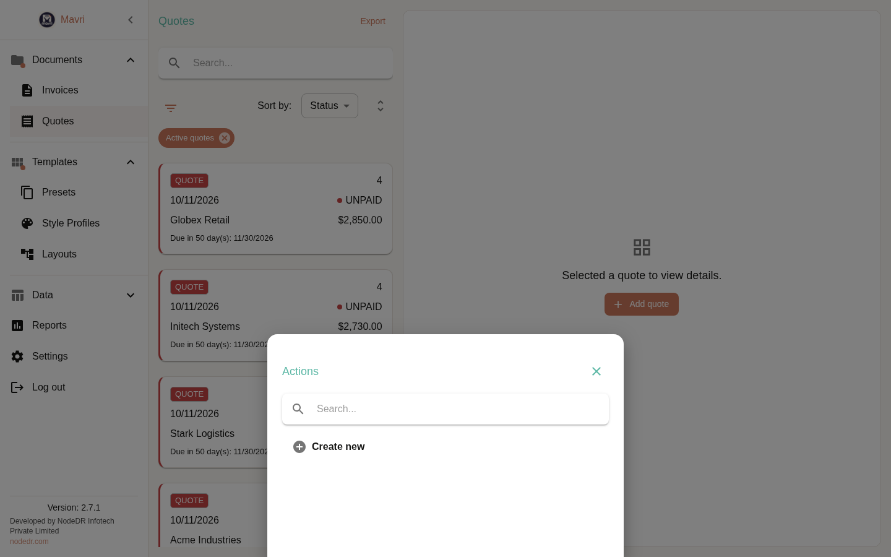
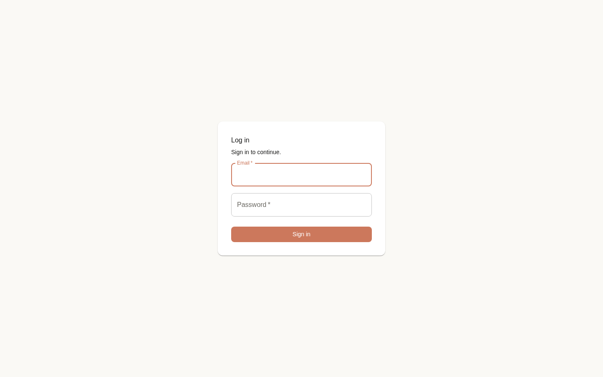
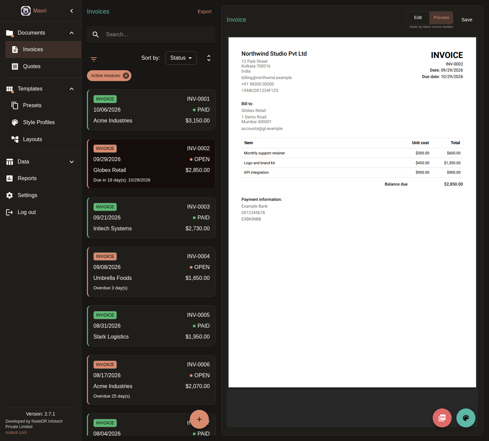

# Mavri tutorial

Get from zero to your first PDF invoice in about five minutes. Screenshots use fictional demo data.

**Contents:** [1. Start](#1-start-the-app) · [2. Create your account](#2-create-your-account) · [3. Add your details](#3-add-your-business-client-and-items) · [4. Create an invoice](#4-create-an-invoice) · [5. Preview & PDF](#5-preview-and-export-a-pdf) · [6. Get paid](#6-record-payments) · [7. Dashboard](#7-the-dashboard) · [8. Everything else](#8-the-other-screens) · [9. Connect other systems](#9-connect-other-systems)

---

## 1. Start the app

There is **no database to set up**. On Docker and CasaOS, Mavri creates its database (`invoice.db`) by itself the first time it starts and keeps it in your data volume.

```bash
docker compose -f docker-compose.standalone.yml up -d
```

Open <http://localhost:3001>. On CasaOS, install the app and open it on port **8473**. (Desktop app: just launch it — it asks where to keep your database file.)

## 2. Create your account

The first time you open Mavri you create the owner account. It takes ten seconds.



Use at least 10 characters with upper case, lower case and a number. This account has full access, so keep the password safe.

You land on an empty **Invoices** screen. That's normal:



Next time, sign in with the same email and password. After ten failed attempts in 15 minutes, sign-in pauses for a while.


## 3. Add your business, client and items

Mavri ships with currencies, units and invoice layouts already installed. You only need three things before your first invoice. Open each from the menu (**Data → …**), press **+ Add**, fill the form and **Save**.

| Add this | Why | Screenshot |
| --- | --- | --- |
| **Business** — your company name, address, tax number, logo | Appears at the top of every invoice |  |
| **Client** — who you are billing | Name and address are printed under *Bill to* |  |
| **Item** — a product or service with a price | Reuse it on any invoice |  |

Optional but nice: a **Bank** (payment details printed on the invoice, with an optional UPI/QR code) and a **Style profile** (colour, font and table look).



Short names are limited to two characters (they become the avatar initials). Once saved, each list shows how many invoices and quotes use a record.


## 4. Create an invoice

1. Open **Invoices** and press the round **+** button.
2. Pick the **currency**, **bank**, **style profile** and **language** at the top.
3. Choose the **business** and the client under **Bill to**.
4. Press **Add item**, pick items and set quantities. Totals, tax and balance due update as you type.
5. Add a discount, shipping, surcharge or tax if you need to, plus notes and terms.
6. **Save**.


Tips: invoice numbers are generated for you (change the prefix in **Settings**), and every invoice keeps a snapshot of your business, client and prices, so later edits never change old invoices.

## 5. Preview and export a PDF

Switch the toggle at the top of an invoice from **Edit** to **Preview** to see the finished PDF. Use the red **PDF** button to download it, or the palette button to adjust colours and layout for that invoice.


You can also export UBL / Peppol BIS 3.0 and XRechnung XML for e-invoicing from the same menu.

## 6. Record payments

Open an invoice, add a payment (amount, date, method) and the status moves to **Partially paid** or **Paid** automatically. Overdue invoices are highlighted in the list.


Prefer quotes first? **Quotes** works the same way, and a quote can be turned into an invoice. You can also start a quote from the dashboard with **Create quote**.




## 7. The dashboard

**Reports** is your dashboard. It answers one question: what needs my attention today?

- **Create invoice** and **Create quote** sit at the top right and open a blank form.
- Change the **date basis** (issued or paid date), **currency** and **date range** from the row below the title.
- Four cards show **Invoiced this period**, **Collection rate**, **Collected** and **Outstanding**.
- **Sales trending** charts cumulative revenue. **Collection rate** compares paid with outstanding.
- **Needs attention** lists overdue invoices, most overdue first, with the total balance owed. It ignores the date range and stays in the selected currency. Invoices without a due date never appear. **View all** jumps to the invoice list.
- **Recent invoices** shows your latest documents. **Show top clients and items** expands the rankings.


Light and dark mode are both supported (**Settings → Dark Mode**).


## 8. The other screens

| Screen | What it's for |
| --- | --- |
| **Clients**, **Items**, **Businesses**, **Banks** | Your reusable details. Search, sort, filter, archive, import/export to XLSX. |
| **Categories**, **Units**, **Currencies** | Organise items and set up extra currencies. |
| **Presets** | One-click templates that fill business, client, bank, notes and signature. |
| **Style profiles** | Colours, fonts, table style, watermark and page size. |
| **Layouts** | The structure of the PDF. Import your own JSON — see [LAYOUT.md](reference/LAYOUT.md). |
| **Integrations** | Connect a webshop so orders become invoices. |
| **Settings** | Language, number and date formats, invoice numbering, backups. |

<table>
<tr>
<td></td>
<td></td>
</tr>
<tr>
<td></td>
<td></td>
</tr>
<tr>
<td></td>
<td></td>
</tr>
<tr>
<td></td>
<td></td>
</tr>
<tr>
<td></td>
<td></td>
</tr>
</table>


### Dark mode

Every screen follows the theme you choose in **Settings**.

<table>
<tr>
<td></td>
<td></td>
</tr>
<tr>
<td></td>
<td></td>
</tr>
</table>



## 9. Connect other systems

Mavri has a small REST API (`/api/v1`) and an MCP server so other tools can create and fetch invoices. See [API.md](reference/API.md). Webshop webhooks (Shopify, WooCommerce, generic) are set up under **Integrations**.

## Backups

Everything lives in one SQLite file (`invoice.db`) in your data folder (`/data` in Docker, `/DATA/AppData/nodedr-invoice/data` on CasaOS). Copy that file to back up. You can also export everything to JSON or XLSX from **Settings**.

## Need more detail?

The long per-screen reference is in [per-screen reference](REFERENCE.md). Questions or bugs: [open an issue](https://github.com/Raktim94/nodedr-invoice/issues).

---

<sub>Mavri is developed by [NodeDR Infotech Private Limited](https://www.nodedr.com/) · [nodedr.com](https://www.nodedr.com/)</sub>
